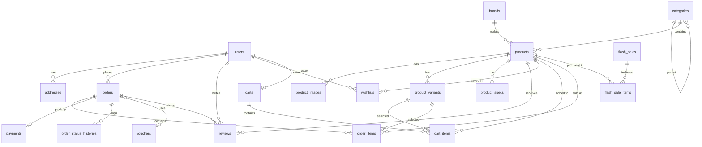

# DATABASE: FishMart Indonesia

| Item | Isi |
|---|---|
| Versi | 1.0 (Draft) |
| DBMS | MySQL 8, engine InnoDB, charset `utf8mb4`, collation `utf8mb4_unicode_ci` |
| Framework | Laravel 12 (Eloquent + Migration) |
| Dokumen terkait | `docs/PRD.md` (bagian 7, 8, dan 9) |

> **Catatan untuk agent AI:** Gunakan dokumen ini sebagai acuan saat membuat migration, model, factory, dan seeder. Ikuti urutan migration di bagian 6 agar foreign key tidak error. Jangan menambah atau mengubah kolom tanpa memperbarui dokumen ini.

---

## 1. Konvensi

| Aspek | Aturan |
|---|---|
| Nama tabel | `snake_case`, jamak (`products`, `order_items`) |
| Primary key | `id` (`bigIncrements`) |
| Foreign key | `{model}_id`, memakai `foreignId()->constrained()` |
| Uang | `unsignedBigInteger` dalam **Rupiah utuh** (tanpa desimal). Contoh: Rp1.250.000 disimpan `1250000` |
| Berat | `unsignedInteger` dalam **gram** |
| Status/enum | Disimpan sebagai `string` dan divalidasi lewat **PHP Backed Enum** (lebih mudah diubah daripada enum MySQL) |
| Timestamp | `created_at`, `updated_at` di semua tabel kecuali pivot sederhana |
| Soft delete | `deleted_at` pada `products` dan `users` |
| Slug | `unique`, dibuat otomatis dari nama |
| Snapshot | Data transaksi (harga, nama produk, alamat) **disalin** ke `order_items`/`orders` agar riwayat tidak berubah saat produk diedit |

## 2. Diagram Relasi (ERD)



---

## 3. Definisi Tabel

### 3.1 `users`

| Kolom | Tipe | Null | Default | Keterangan |
|---|---|---|---|---|
| id | bigint unsigned PK | | | |
| name | varchar(100) | | | |
| email | varchar(150) | | | unique |
| email_verified_at | timestamp | ✔ | | |
| password | varchar(255) | | | hashed |
| phone | varchar(20) | ✔ | | |
| avatar | varchar(255) | ✔ | | path file |
| role | varchar(20) | | `customer` | `customer` / `admin` |
| is_active | boolean | | true | admin dapat menonaktifkan |
| remember_token | varchar(100) | ✔ | | |
| created_at, updated_at, deleted_at | timestamp | | | soft delete |

Index: `unique(email)`, `index(role)`.

### 3.2 `addresses`

| Kolom | Tipe | Null | Default | Keterangan |
|---|---|---|---|---|
| id | bigint PK | | | |
| user_id | FK → users | | | cascade on delete |
| label | varchar(50) | ✔ | | mis. Rumah, Kantor |
| recipient_name | varchar(100) | | | |
| phone | varchar(20) | | | |
| province_id | varchar(20) | | | ID dari API wilayah/ongkir |
| province | varchar(100) | | | |
| city_id | varchar(20) | | | dipakai untuk hitung ongkir |
| city | varchar(100) | | | |
| district | varchar(100) | ✔ | | kecamatan |
| postal_code | varchar(10) | | | |
| detail | text | | | jalan, nomor, patokan |
| is_default | boolean | | false | hanya satu per user |
| created_at, updated_at | timestamp | | | |

Index: `index(user_id)`.

### 3.3 `categories`

| Kolom | Tipe | Null | Default | Keterangan |
|---|---|---|---|---|
| id | bigint PK | | | |
| parent_id | FK → categories | ✔ | | subkategori, `nullOnDelete` |
| name | varchar(100) | | | |
| slug | varchar(120) | | | unique |
| icon | varchar(255) | ✔ | | gambar/ikon untuk grid kategori homepage |
| sort_order | smallint | | 0 | urutan tampil |
| is_active | boolean | | true | |
| created_at, updated_at | timestamp | | | |

### 3.4 `brands`

| Kolom | Tipe | Null | Default | Keterangan |
|---|---|---|---|---|
| id | bigint PK | | | |
| name | varchar(100) | | | mis. Shimano, Daiwa |
| slug | varchar(120) | | | unique |
| logo | varchar(255) | ✔ | | |
| is_active | boolean | | true | |
| created_at, updated_at | timestamp | | | |

### 3.5 `products`

| Kolom | Tipe | Null | Default | Keterangan |
|---|---|---|---|---|
| id | bigint PK | | | |
| category_id | FK → categories | | | `restrictOnDelete` |
| brand_id | FK → brands | ✔ | | `nullOnDelete` |
| name | varchar(200) | | | |
| slug | varchar(220) | | | unique |
| sku | varchar(50) | ✔ | | unique |
| short_description | varchar(300) | ✔ | | |
| description | longtext | ✔ | | |
| price | unsigned bigint | | | harga normal |
| sale_price | unsigned bigint | ✔ | | harga diskon biasa (non flash sale) |
| stock | unsigned int | | 0 | stok produk (dipakai bila tanpa varian) |
| weight_gram | unsigned int | | | wajib, untuk ongkir |
| has_variants | boolean | | false | jika true, stok dan harga mengikuti varian |
| sold_count | unsigned int | | 0 | denormalisasi untuk sort terlaris |
| rating_avg | decimal(3,2) | | 0 | denormalisasi dari reviews |
| rating_count | unsigned int | | 0 | |
| is_active | boolean | | true | |
| is_featured | boolean | | false | |
| created_at, updated_at, deleted_at | timestamp | | | soft delete |

Index: `unique(slug)`, `unique(sku)`, `index(category_id)`, `index(brand_id)`, `index(is_active, created_at)`, `index(sold_count)`, `index(price)`, `fulltext(name, short_description)` untuk pencarian.

### 3.6 `product_images`

| Kolom | Tipe | Null | Default | Keterangan |
|---|---|---|---|---|
| id | bigint PK | | | |
| product_id | FK → products | | | cascade |
| path | varchar(255) | | | |
| alt | varchar(150) | ✔ | | |
| sort_order | smallint | | 0 | |
| is_primary | boolean | | false | satu per produk |
| created_at, updated_at | timestamp | | | |

### 3.7 `product_variants`

| Kolom | Tipe | Null | Default | Keterangan |
|---|---|---|---|---|
| id | bigint PK | | | |
| product_id | FK → products | | | cascade |
| name | varchar(100) | | | mis. "2.10m / Medium" |
| sku | varchar(50) | ✔ | | unique |
| price | unsigned bigint | | | |
| sale_price | unsigned bigint | ✔ | | |
| stock | unsigned int | | 0 | |
| weight_gram | unsigned int | ✔ | | jika null, pakai berat produk |
| is_active | boolean | | true | |
| created_at, updated_at | timestamp | | | |

### 3.8 `product_specs`

| Kolom | Tipe | Null | Default | Keterangan |
|---|---|---|---|---|
| id | bigint PK | | | |
| product_id | FK → products | | | cascade |
| label | varchar(100) | | | mis. Panjang, Material, Line Rating |
| value | varchar(255) | | | |
| sort_order | smallint | | 0 | |

### 3.9 `flash_sales`

| Kolom | Tipe | Null | Default | Keterangan |
|---|---|---|---|---|
| id | bigint PK | | | |
| name | varchar(150) | | | mis. "Flash Sale Weekend Festival" |
| starts_at | datetime | | | |
| ends_at | datetime | | | |
| is_active | boolean | | true | |
| created_at, updated_at | timestamp | | | |

Index: `index(starts_at, ends_at)`.

### 3.10 `flash_sale_items`

| Kolom | Tipe | Null | Default | Keterangan |
|---|---|---|---|---|
| id | bigint PK | | | |
| flash_sale_id | FK → flash_sales | | | cascade |
| product_id | FK → products | | | cascade |
| product_variant_id | FK → product_variants | ✔ | | jika promo per varian |
| sale_price | unsigned bigint | | | |
| quota | unsigned int | | | jumlah maksimum terjual saat promo |
| sold | unsigned int | | 0 | untuk indikator "terjual" |

Index: `unique(flash_sale_id, product_id, product_variant_id)`.

### 3.11 `carts`

| Kolom | Tipe | Null | Default | Keterangan |
|---|---|---|---|---|
| id | bigint PK | | | |
| user_id | FK → users | ✔ | | null untuk guest |
| session_id | varchar(100) | ✔ | | untuk guest |
| created_at, updated_at | timestamp | | | |

Index: `unique(user_id)`, `index(session_id)`. Saat login, keranjang session digabung ke keranjang user lalu dihapus.

### 3.12 `cart_items`

| Kolom | Tipe | Null | Default | Keterangan |
|---|---|---|---|---|
| id | bigint PK | | | |
| cart_id | FK → carts | | | cascade |
| product_id | FK → products | | | cascade |
| product_variant_id | FK → product_variants | ✔ | | |
| quantity | unsigned int | | 1 | |
| is_selected | boolean | | true | checkbox pilih item |
| created_at, updated_at | timestamp | | | |

Index: `unique(cart_id, product_id, product_variant_id)`.

### 3.13 `vouchers`

| Kolom | Tipe | Null | Default | Keterangan |
|---|---|---|---|---|
| id | bigint PK | | | |
| code | varchar(30) | | | unique, uppercase |
| description | varchar(255) | ✔ | | |
| type | varchar(10) | | | `percent` / `fixed` |
| value | unsigned int | | | persen (1–100) atau nominal Rp |
| min_purchase | unsigned bigint | | 0 | |
| max_discount | unsigned bigint | ✔ | | plafon untuk tipe percent |
| quota | unsigned int | ✔ | | null = tanpa batas |
| used_count | unsigned int | | 0 | |
| starts_at | datetime | ✔ | | |
| ends_at | datetime | ✔ | | |
| is_active | boolean | | true | |
| created_at, updated_at | timestamp | | | |

### 3.14 `orders`

| Kolom | Tipe | Null | Default | Keterangan |
|---|---|---|---|---|
| id | bigint PK | | | |
| invoice_no | varchar(30) | | | unique, mis. `INV/20260930/0001` |
| user_id | FK → users | | | `restrictOnDelete` |
| voucher_id | FK → vouchers | ✔ | | `nullOnDelete` |
| voucher_code | varchar(30) | ✔ | | snapshot |
| status | varchar(20) | | `pending_payment` | lihat enum bagian 4 |
| recipient_name | varchar(100) | | | snapshot alamat |
| recipient_phone | varchar(20) | | | |
| shipping_address | text | | | alamat lengkap (gabungan) |
| shipping_city_id | varchar(20) | | | |
| postal_code | varchar(10) | | | |
| courier | varchar(30) | | | mis. jne, jnt |
| shipping_service | varchar(50) | | | mis. REG, YES |
| shipping_etd | varchar(30) | ✔ | | estimasi tiba |
| shipping_cost | unsigned bigint | | 0 | |
| total_weight_gram | unsigned int | | | |
| subtotal | unsigned bigint | | | |
| discount_amount | unsigned bigint | | 0 | |
| grand_total | unsigned bigint | | | subtotal − diskon + ongkir |
| tracking_no | varchar(50) | ✔ | | nomor resi |
| note | text | ✔ | | catatan pembeli |
| paid_at | datetime | ✔ | | |
| shipped_at | datetime | ✔ | | |
| completed_at | datetime | ✔ | | |
| cancelled_at | datetime | ✔ | | |
| cancel_reason | varchar(255) | ✔ | | |
| expires_at | datetime | ✔ | | batas bayar (24 jam) |
| created_at, updated_at | timestamp | | | |

Index: `unique(invoice_no)`, `index(user_id, status)`, `index(status, expires_at)`, `index(created_at)`.

### 3.15 `order_items`

| Kolom | Tipe | Null | Default | Keterangan |
|---|---|---|---|---|
| id | bigint PK | | | |
| order_id | FK → orders | | | cascade |
| product_id | FK → products | ✔ | | `nullOnDelete` |
| product_variant_id | FK → product_variants | ✔ | | `nullOnDelete` |
| product_name | varchar(200) | | | snapshot |
| variant_name | varchar(100) | ✔ | | snapshot |
| image | varchar(255) | ✔ | | snapshot |
| price | unsigned bigint | | | harga satuan saat beli (sudah termasuk diskon/flash sale) |
| quantity | unsigned int | | | |
| weight_gram | unsigned int | | | |
| subtotal | unsigned bigint | | | price × quantity |

### 3.16 `payments`

| Kolom | Tipe | Null | Default | Keterangan |
|---|---|---|---|---|
| id | bigint PK | | | |
| order_id | FK → orders | | | cascade, unique |
| gateway | varchar(20) | | `midtrans` | |
| method | varchar(50) | ✔ | | bank_transfer, qris, gopay, dll |
| gateway_order_id | varchar(60) | | | unique, dikirim ke Midtrans |
| gateway_transaction_id | varchar(100) | ✔ | | |
| snap_token | varchar(255) | ✔ | | |
| status | varchar(20) | | `pending` | `pending`/`paid`/`failed`/`expired`/`refunded` |
| amount | unsigned bigint | | | |
| payload | json | ✔ | | body webhook terakhir |
| paid_at | datetime | ✔ | | |
| created_at, updated_at | timestamp | | | |

### 3.17 `order_status_histories`

| Kolom | Tipe | Null | Default | Keterangan |
|---|---|---|---|---|
| id | bigint PK | | | |
| order_id | FK → orders | | | cascade |
| status | varchar(20) | | | |
| note | varchar(255) | ✔ | | |
| changed_by | FK → users | ✔ | | null jika sistem/webhook |
| created_at | timestamp | | | |

### 3.18 `reviews`

| Kolom | Tipe | Null | Default | Keterangan |
|---|---|---|---|---|
| id | bigint PK | | | |
| user_id | FK → users | | | cascade |
| product_id | FK → products | | | cascade |
| order_id | FK → orders | | | pastikan pembeli sah |
| rating | tinyint unsigned | | | 1–5 |
| comment | text | ✔ | | |
| images | json | ✔ | | array path foto |
| is_visible | boolean | | true | moderasi admin |
| created_at, updated_at | timestamp | | | |

Index: `unique(user_id, product_id, order_id)`, `index(product_id, is_visible)`.

### 3.19 `wishlists`

| Kolom | Tipe | Null | Default | Keterangan |
|---|---|---|---|---|
| user_id | FK → users | | | cascade |
| product_id | FK → products | | | cascade |
| created_at | timestamp | | | |

Primary key gabungan: `(user_id, product_id)`.

### 3.20 `banners`

| Kolom | Tipe | Null | Default | Keterangan |
|---|---|---|---|---|
| id | bigint PK | | | |
| title | varchar(150) | | | mis. "Eksplorasi Laut Lepas & Pesisir Nusantara" |
| subtitle | varchar(255) | ✔ | | |
| image | varchar(255) | | | |
| cta_label | varchar(50) | ✔ | | |
| cta_url | varchar(255) | ✔ | | |
| sort_order | smallint | | 0 | |
| is_active | boolean | | true | |
| created_at, updated_at | timestamp | | | |

### 3.21 Tabel bawaan Laravel

`password_reset_tokens`, `sessions`, `cache`, `cache_locks`, `jobs`, `job_batches`, `failed_jobs`. Dibuat otomatis oleh starter kit. Pastikan `QUEUE_CONNECTION=database` bila memakai queue database.

---

## 4. Enum (PHP Backed Enum)

Simpan di `app/Enums/`.

| Enum | Nilai |
|---|---|
| `UserRole` | `customer`, `admin` |
| `OrderStatus` | `pending_payment`, `paid`, `processing`, `shipped`, `completed`, `cancelled`, `expired`, `refunded` |
| `PaymentStatus` | `pending`, `paid`, `failed`, `expired`, `refunded` |
| `VoucherType` | `percent`, `fixed` |

Alur status pesanan:

```
pending_payment ──► paid ──► processing ──► shipped ──► completed
      │               │
      ├──► expired    └──► refunded
      └──► cancelled
```

## 5. Logika Data Penting

**Harga efektif produk** (urutan prioritas):
1. Harga flash sale, jika ada `flash_sale_items` pada `flash_sales` yang sedang aktif **dan** `sold < quota`.
2. `sale_price` (varian atau produk) jika tidak null.
3. `price`.

**Stok:**
- Produk tanpa varian memakai `products.stock`; produk dengan varian memakai `product_variants.stock`.
- Kurangi stok di dalam **DB transaction** dengan `lockForUpdate()` saat membuat pesanan agar tidak terjadi oversell.
- Kembalikan stok saat status menjadi `cancelled` atau `expired`.
- Tambah `sold_count` (dan `flash_sale_items.sold` bila promo) saat pembayaran berhasil.

**Rating:** setiap ulasan dibuat/diubah/disembunyikan, hitung ulang `rating_avg` dan `rating_count` di `products`.

**Nomor invoice:** format `INV/YYYYMMDD/NNNN`, urutan harian, dibuat dalam transaction.

**Data admin dashboard (query agregat):**
- Total penjualan = `SUM(grand_total)` pada order berstatus `paid`, `processing`, `shipped`, `completed`.
- Grafik penjualan = `GROUP BY DATE(paid_at)` (harian) atau `DATE_FORMAT(paid_at, '%Y-%m')` (bulanan).
- Produk terlaris = `SUM(order_items.quantity)` per produk pada rentang waktu.
- Stok menipis = `stock <= 5` (ambang batas dikonfigurasi).

## 6. Urutan Migration

Buat berurutan agar foreign key valid:

1. `users` (tambah kolom `phone`, `avatar`, `role`, `is_active`, `deleted_at`)
2. `addresses`
3. `categories`
4. `brands`
5. `products`
6. `product_images`
7. `product_variants`
8. `product_specs`
9. `flash_sales`
10. `flash_sale_items`
11. `carts`
12. `cart_items`
13. `vouchers`
14. `orders`
15. `order_items`
16. `payments`
17. `order_status_histories`
18. `reviews`
19. `wishlists`
20. `banners`

## 7. Seeder

Urutan pemanggilan di `DatabaseSeeder`:

| Seeder | Isi |
|---|---|
| `UserSeeder` | 1 admin (`admin@fishmart.test`), 5–10 customer contoh |
| `CategorySeeder` | Joran, Reel, Umpan Buatan, Pancing & Kili-kili, Pakaian & Aksesori, Sepatu, Tas & Box, Perlengkapan Lain |
| `BrandSeeder` | Shimano, Daiwa, Penn, Abu Garcia, Maxel, Owner, dan lainnya |
| `ProductSeeder` | 40–60 produk dengan factory: gambar, spesifikasi, sebagian punya varian |
| `FlashSaleSeeder` | 1 flash sale aktif berisi 6–8 produk |
| `VoucherSeeder` | 3 voucher contoh (persen, nominal, ongkir) |
| `BannerSeeder` | 2–3 banner hero |
| `OrderSeeder` | 20–30 pesanan berbagai status dan tanggal (agar grafik dashboard terisi) |
| `ReviewSeeder` | Ulasan untuk pesanan berstatus `completed` |

Buat juga **Factory** untuk: `User`, `Product`, `Order`, `Review`.

## 8. Relasi Eloquent

| Model | Relasi |
|---|---|
| `User` | `hasMany(Address)`, `hasMany(Order)`, `hasMany(Review)`, `hasOne(Cart)`, `belongsToMany(Product, 'wishlists')` |
| `Category` | `belongsTo(parent)`, `hasMany(children)`, `hasMany(Product)` |
| `Brand` | `hasMany(Product)` |
| `Product` | `belongsTo(Category)`, `belongsTo(Brand)`, `hasMany(ProductImage)`, `hasMany(ProductVariant)`, `hasMany(ProductSpec)`, `hasMany(Review)`, `hasMany(FlashSaleItem)` |
| `FlashSale` | `hasMany(FlashSaleItem)` |
| `Cart` | `belongsTo(User)`, `hasMany(CartItem)` |
| `Order` | `belongsTo(User)`, `belongsTo(Voucher)`, `hasMany(OrderItem)`, `hasOne(Payment)`, `hasMany(OrderStatusHistory)` |
| `Review` | `belongsTo(User)`, `belongsTo(Product)`, `belongsTo(Order)` |

## 9. Catatan Keamanan dan Kinerja Data

- Jangan percaya harga, ongkir, atau total dari browser; hitung ulang di server dari data tabel.
- Simpan hanya path gambar di database; file di `storage/app/public` (jalankan `php artisan storage:link`).
- Payload webhook disimpan untuk audit, tetapi jangan menyimpan data kartu atau kredensial.
- Gunakan eager loading (`with()`) pada daftar produk dan pesanan untuk mencegah N+1.
- Jalankan scheduled job tiap 5–10 menit: batalkan pesanan `pending_payment` yang `expires_at`-nya lewat dan kembalikan stok.
- Backup database berkala sebelum deploy dan sebelum migration di production.
